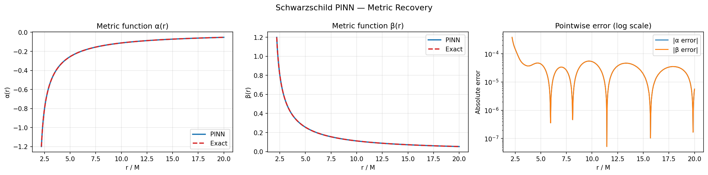
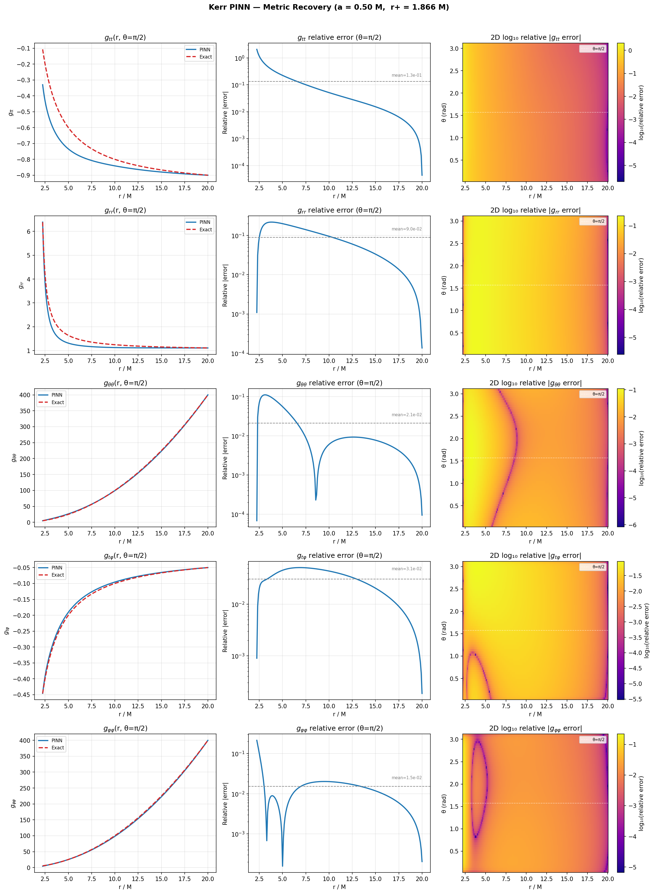

# Recovering Black Hole Metrics with Physics-Informed Neural Networks

Physics-informed neural networks (PINNs) in PyTorch that recover exact solutions of general relativity directly from the vacuum Einstein field equations, $R_{\mu\nu} = 0$, without any labeled solution data. The analytic solutions are used only to benchmark the results.

- **Schwarzschild** (non-rotating black hole): the main project, presented at the TJHSST tjSTAR research symposium with an accompanying paper.
- **Kerr** (rotating black hole): an independent follow-up that extends the method to a 2D, five-component problem.

Authors: Anant Krishna and Sujoge Dua, Quantum Information and Optics Research Lab (QLab), Thomas Jefferson High School for Science and Technology. The Kerr extension is by Anant Krishna.

## Schwarzschild



The network learns $\alpha(r)$ in the static, spherically symmetric ansatz

$$ds^2 = -e^{2\alpha(r)}dt^2 + e^{2\beta(r)}dr^2 + r^2 d\Omega^2.$$

- **Hard constraint:** $\beta = -\alpha$ is derived analytically from $R_{tt} - R_{rr} = 0$ and built into the architecture, so the network outputs a single function.
- **Loss:** mean-squared residuals of $R_{tt}$ and $R_{\theta\theta}$ (computed with second-order autograd), plus a Misner–Sharp quasi-local mass term that selects the mass $M$ without using solution values.
- **Training:** 5×64 tanh MLP, 1,000 log-uniform collocation points per epoch on $r \in [1.1\,r_s, 20M]$; 20,000 Adam epochs with cosine warm restarts, then L-BFGS refinement.
- **Result:** $L^2$ error on the order of $10^{-4}$ against the exact solution. `figures/extrapolation_diagnostic.png` tests how the learned metric behaves outside the training domain.

## Kerr



The Kerr problem has no algebraic reduction like $\beta = -\alpha$. The network maps $(r, \theta)$ to five metric components $g_{tt}, g_{rr}, g_{\theta\theta}, g_{t\phi}, g_{\phi\phi}$ in Boyer–Lindquist coordinates ($a = 0.5M$). The off-diagonal component $g_{t\phi}$ is the frame-dragging term. Christoffel symbols and the full Ricci tensor are computed from the network output by automatic differentiation, with no hand-derived field equations.

Getting this to train took five versions; the reasoning for each change is documented in comments in `kerr/kerr_pinn.py`:

- **Scale mismatch** between components (v1): fixed by having the network output $O(1)$ shape functions that are multiplied by known coordinate scales.
- **Exploding residuals** (up to ~$10^{14}$ early in training): fixed with a curriculum that ramps up the PDE-loss weight after a boundary-condition warmup, plus residual clamping.
- **Local minima near the horizon:** fixed with selective inner boundary conditions. Pinning all five components (v4) made $g_{tt}$ and $g_{rr}$ worse, so only the components that failed without one are constrained.

**Results:** $g_{\theta\theta}$, $g_{t\phi}$, and $g_{\phi\phi}$ are recovered to 1.5–3% mean relative error, and the frame-dragging angular velocity closely tracks the exact solution (`kerr/figures/kerr_frame_dragging.png`). $g_{tt}$ and $g_{rr}$ did not fully converge (about 9–13% mean relative error); closing that gap, for example with horizon-penetrating coordinates or adaptive loss weighting, is left as future work. Earlier versions are kept in `kerr/previous_versions/`.

## Running

```bash
pip install -r requirements.txt
python schwarzschild/schwarzschild_pinn.py
python kerr/kerr_pinn.py
```

Each script trains from scratch, uses a GPU if one is available, and saves its figures to the current directory.

## Paper and presentation

- [`paper/Recovering_the_Schwarzschild_Metric_through_PINNs.pdf`](paper/Recovering_the_Schwarzschild_Metric_through_PINNs.pdf)
- [`paper/tjSTAR_presentation.pdf`](paper/tjSTAR_presentation.pdf)
- [`paper/tjSTAR_poster.pdf`](paper/tjSTAR_poster.pdf)
